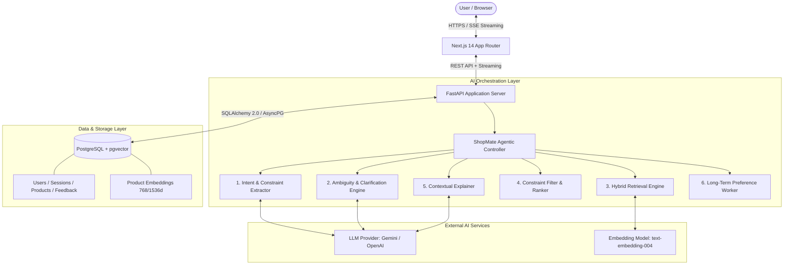
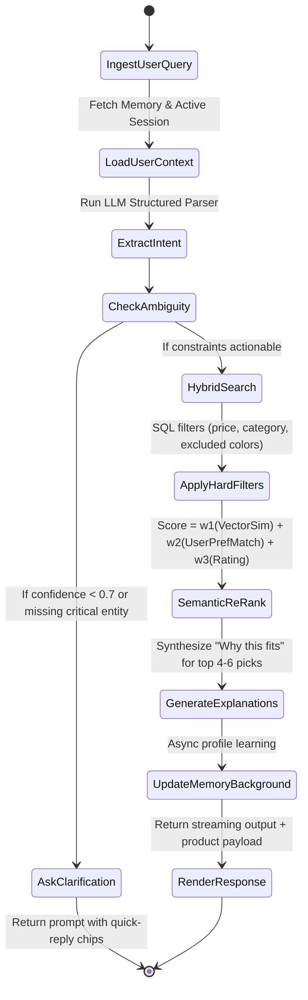
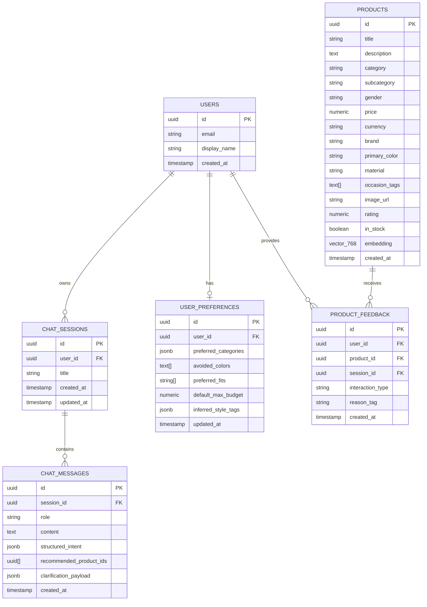

# ShopMate AI — 0→1 Architectural Blueprint & Technical Specification

## 1. Executive Summary & Tech Stack Matrix

ShopMate AI transforms vague, multi-constraint user intent (e.g., *"Going to Goa for 4 days, casual outfits under ₹5,000, no bright colors"*) into curated, explainable, and personalized product recommendations.

To balance rapid MVP delivery with production-grade extensibility, the system uses a **decoupled Python + TypeScript architecture**:
*   **Frontend**: Next.js 14 (App Router) + Tailwind CSS + Shadcn UI (optimized for conversational commerce with streaming UI widgets).
*   **Backend**: FastAPI (Python 3.11) with Pydantic v2 (high-performance asynchronous API, native typing, seamless LLM ecosystem integration).
*   **Database & Vector Engine**: PostgreSQL with `pgvector` (via Supabase or Neon) — unified relational state, conversation memory, and vector embeddings in a single database to eliminate multi-datastore operational overhead.
*   **AI / Orchestration**: LiteLLM / Google GenAI SDK with structured outputs + lightweight state-machine graph (LangGraph or custom lightweight DAG) with Gemini 2.0 Flash / GPT-4o-mini.

---

## 2. System Architecture Overview



---

## 3. Frontend Architecture (Next.js 14)

### 3.1 Design Principles
*   **Conversational Canvas UI**: Not just a plain chat window, but a hybrid "Chat + Living Wardrobe / Product Canvas".
*   **Server-Sent Events (SSE)**: Real-time token streaming for explanations alongside structured JSON blocks for product cards.
*   **Optimistic UI Updates**: Feedback (like/dislike/save) reflects instantly while syncing in the background.

### 3.2 Key UI Components
*   `ChatInterface`: Message feed, auto-scroll, dynamic suggestion pills, and query input bar.
*   `ClarificationWidget`: Interactive single/multi-choice chip groups (e.g., *"What style of shirts do you prefer? [Linen] [Cotton Casual] [Resort Print]"*).
*   `ProductGrid` & `ProductCard`:
    *   Image, Title, Price, Discount badge.
    *   **Fit Reason Badge**: Highlight why it matched (e.g., *"Matches: Goa beach casual • Neutral tones"*).
    *   Direct comparison checkbox.
    *   Like / Dislike / Dismiss buttons.
*   `ComparisonDrawer / Modal`: Side-by-side matrix comparing price, fabric, suitability score, and trade-offs.
*   `UserPreferenceDrawer`: View and edit discovered preferences (e.g., *"We remember: Dislikes neon, prefers breathable fabrics, Budget ceiling ₹5,000"*).

### 3.3 State Management
*   **Zustand**: Lightweight global store for session ID, active comparison items, active filters, and preference cache.
*   **TanStack Query (React Query)**: Caching catalog queries, user history, and background mutations.

---

## 4. Backend Architecture (FastAPI)

### 4.1 Modular Layered Design
```
backend/
├── app/
│   ├── api/            # API Route controllers (v1)
│   ├── core/           # Config, logging, security, database sessions
│   ├── services/       # Business logic (Catalog, Agent, Memory, Reranker)
│   ├── schemas/        # Pydantic v2 validation models
│   ├── models/         # SQLAlchemy ORM models
│   └── agent/          # State machine nodes, prompts, tools
```

### 4.2 Error Handling & Resilience
*   **Graceful LLM Degradation**: If structured extraction encounters validation errors, fallback to rule-based keyword search on catalog attributes.
*   **Circuit Breakers**: Timeout thresholds (5s for LLM calls, 1s for vector search) to prevent hanging user sessions.
*   **Connection Pooling**: Asyncpg pool with health checks to ensure sub-100ms database roundtrips.

---

## 5. AI & Agent Architecture

The agent is organized as a deterministic State-Machine DAG. This ensures controllable outputs, low hallucination risk, and debuggability.



### 5.1 Step-by-Step Agent Workflow

1.  **Intent & Constraint Extraction**:
    *   Transforms raw text into a strict Pydantic model (`ExtractedIntent`).
    *   Computes derived needs: "Goa for 4 days" $\rightarrow$ `recommended_bundle`: 2-3 casual shirts/t-shirts, 1-2 shorts/linen trousers, 1 footwear; `climate`: hot/humid; `vibe`: resort/beach casual.
2.  **Ambiguity Scoring & Clarification**:
    *   Checks if critical parameters are absent (e.g., target gender or category when unspecified).
    *   If missing, formulates **1 targeted question** with 3-4 interactive quick-reply chips.
3.  **Hybrid Retrieval (Dense + Sparse)**:
    *   **Dense**: Embedding search on `description_vector` using cosine distance ($1 - \text{cosine\_similarity}$).
    *   **Sparse**: Full-text keyword search on `title` + `brand` + `tags`.
    *   **Reciprocal Rank Fusion (RRF)**: Combines dense and sparse rank scores.
4.  **Hard Constraint Filtering**:
    *   Direct SQL predicates: `price <= max_budget`, `category IN (...)`, `color NOT IN (...)`.
5.  **Multi-Factor Reranking**:
    $$\text{FinalScore} = 0.50 \cdot S_{\text{vector}} + 0.25 \cdot S_{\text{preference}} + 0.15 \cdot S_{\text{rating}} + 0.10 \cdot S_{\text{deal}}$$
6.  **Contextual Explanation Generation**:
    *   For the top 4 recommended items, generates a concise, 1-sentence explanation linking the product directly to user constraints (e.g., *"100% linen fabric stays breathable in Goa's humidity, while the olive green tone honors your preference against bright colors."*).
7.  **Preference Memory Updater**:
    *   Background event processor analyzes explicit queries and feedback to update the user's persistent profile (e.g., `avoided_colors: ["neon", "bright yellow"]`).

---

## 6. Database Schema & Data Models

### 6.1 Relational & Vector Schema (PostgreSQL + pgvector)



### 6.2 Key Indexes
*   `CREATE INDEX idx_products_embedding ON products USING hnsw (embedding vector_cosine_ops);`
*   `CREATE INDEX idx_products_category_price ON products (category, price);`
*   `CREATE INDEX idx_products_fts ON products USING gin(to_tsvector('english', title || ' ' || description || ' ' || brand));`

---

## 7. Data Contracts (Pydantic / TypeScript)

### 7.1 Intent Extraction Contract (`schemas/intent.py`)
```python
from pydantic import BaseModel, Field
from typing import List, Optional

class BudgetRange(BaseModel):
    min_amount: Optional[float] = None
    max_amount: Optional[float] = None
    currency: str = "INR"

class ExtractedIntent(BaseModel):
    primary_occasion: Optional[str] = Field(description="e.g. Goa beach trip, wedding, gym")
    duration_days: Optional[int] = Field(description="Duration mentioned in prompt, e.g. 4")
    gender_target: Optional[str] = Field(description="Men, Women, Unisex, or Unknown")
    target_categories: List[str] = Field(default_factory=list, description="e.g. ['shirts', 'shorts', 'sandals']")
    budget: Optional[BudgetRange] = None
    style_vibe: List[str] = Field(default_factory=list, description="e.g. ['casual', 'resort', 'breathable']")
    excluded_attributes: List[str] = Field(default_factory=list, description="e.g. ['bright colors', 'neon']")
    confidence_score: float = Field(ge=0.0, le=1.0)
    requires_clarification: bool = False
    clarification_question: Optional[str] = None
    clarification_options: Optional[List[str]] = None
```

### 7.2 Product Response Contract (`schemas/recommendation.py`)
```python
class RecommendedProduct(BaseModel):
    product_id: str
    title: str
    brand: str
    price: float
    currency: str
    image_url: str
    rating: float
    color: str
    material: str
    fit_explanation: str  # Direct rationale linked to query constraints
    match_score: float

class ShoppingAgentResponse(BaseModel):
    session_id: str
    message: str
    clarification_needed: bool
    clarification_question: Optional[str]
    clarification_chips: Optional[List[str]]
    products: List[RecommendedProduct]
    comparison_summary: Optional[str] = None
```

---

## 8. API Specification

| Endpoint | Method | Purpose | Key Payload / Response |
| :--- | :--- | :--- | :--- |
| `/api/v1/chat/message` | `POST` (SSE) | Send user query & stream conversational reasoning + JSON card payloads | `session_id`, `message` $\rightarrow$ Streaming SSE events |
| `/api/v1/chat/clarify` | `POST` | Submit user response to clarification chip | `session_id`, `question_id`, `selected_option` |
| `/api/v1/products/compare` | `POST` | Compare 2-4 selected products side-by-side | `product_ids: [uuid]` $\rightarrow$ Feature matrix + comparative pro/con |
| `/api/v1/feedback` | `POST` | Log feedback (like, dislike, dismiss, reason) | `product_id`, `interaction_type`, `reason_tag` |
| `/api/v1/user/preferences` | `GET / PUT` | View or adjust explicit preference profile | Returns/updates `UserPreferences` |
| `/api/v1/catalog/search` | `GET` | Direct faceted catalog query | Filters: `category`, `price_max`, `q` |

---

## 9. Folder Structure

```
shopmate-ai/
├── README.md
├── docker-compose.yml          # Local Postgres + pgvector + FastAPI + Next.js
│
├── frontend/                   # Next.js 14 App Router
│   ├── src/
│   │   ├── app/
│   │   │   ├── layout.tsx
│   │   │   ├── page.tsx        # Main Chat + Canvas workspace
│   │   │   └── api/            # Proxy routes if needed
│   │   ├── components/
│   │   │   ├── chat/           # ChatWindow, MessageBubble, ClarificationPill
│   │   │   ├── product/        # ProductCard, ProductGrid, FitBadge, CompareModal
│   │   │   └── preferences/    # PreferenceDrawer
│   │   ├── hooks/              # useChatStream, useComparison, usePreferences
│   │   ├── stores/             # zustand store for UI state
│   │   └── types/              # TypeScript interfaces mirroring backend schemas
│   ├── package.json
│   └── tailwind.config.ts
│
├── backend/                    # FastAPI Application
│   ├── app/
│   │   ├── main.py             # App lifecycle, middleware, CORS
│   │   ├── api/
│   │   │   └── v1/             # Endpoints: chat, products, feedback, user
│   │   ├── core/
│   │   │   ├── config.py       # Pydantic Settings (.env handling)
│   │   │   └── db.py           # Async engine & sessionmaker
│   │   ├── models/             # SQLAlchemy ORM definitions
│   │   ├── schemas/            # Pydantic request/response schemas
│   │   ├── agent/
│   │   │   ├── graph.py        # Agent workflow controller
│   │   │   ├── prompts.py      # Structured system prompts & few-shots
│   │   │   ├── extractor.py    # Intent parsing
│   │   │   ├── retriever.py    # pgvector hybrid search
│   │   │   ├── ranker.py       # Scoring & constraint verification
│   │   │   └── explainer.py    # Explanation generator
│   │   └── services/           # Catalog seeders, memory workers
│   ├── requirements.txt
│   └── tests/
│
└── data/                       # Seed datasets & Evaluation benchmark
    ├── seed_catalog.json       # 100+ curated fashion & lifestyle products
    └── eval_dataset.json       # 50 golden shopping queries for automated testing
```

---

## 10. Security, Privacy & Guardrails

1.  **Prompt Injection & Goal Hijacking**:
    *   Separate system instructions from user inputs with strict markdown delimiters (`<user_intent>...</user_intent>`).
    *   Input pre-filter check: Reject queries attempting system prompt leak or non-shopping commands with a polite redirection.
2.  **SQL / Vector Injection Protection**:
    *   No dynamic raw SQL string interpolation. All metadata filters construct parameterized queries via SQLAlchemy query builder.
3.  **Budget & Boundary Guardrails**:
    *   Deterministic post-filter verification: If the LLM selects a ₹6,000 product when the user requested under ₹5,000, the deterministic ranker rejects it before rendering.
4.  **PII & Data Safety**:
    *   Only persist non-PII shopping attributes in preference memory (e.g., sizes, color tastes). Scrub phone numbers, addresses, and payment details from chat transcripts.

---

## 11. Evaluation Strategy

To ensure recommendations remain high-quality and free of hallucinations, ShopMate AI utilizes a 3-tier evaluation framework:

### 11.1 Offline Golden Evaluation Dataset (50 Benchmark Queries)
*   Covers edge cases: multi-constraint ("Goa 4 days < 5k"), negative constraints ("no synthetics", "no bright colors"), ambiguous inputs ("need clothes for weekend"), and tight budget constraints.

### 11.2 Evaluation Metrics
| Metric | Target | How It Is Measured |
| :--- | :--- | :--- |
| **Constraint Adherence Rate** | $\ge 98\%$ | Automated script verifying that 100% of recommended items respect `price <= max_budget` and `color NOT IN excluded`. |
| **Intent Extraction F1** | $\ge 92\%$ | Evaluated against ground-truth labels for occasion, category, budget bounds. |
| **Explanation Faithfulness** | $\ge 95\%$ | LLM-as-a-judge: does the explanation state attributes that are actually in the product record? (Zero hallucinated materials/features). |
| **Clarification Precision** | $\ge 90\%$ | Did the agent only clarify when critical information was truly ambiguous? |
| **End-to-End Latency** | $< 2.0\text{s}$ | Time-to-First-Token (TTFT) $< 500\text{ms}$ on streaming; full recommendation cards delivered $< 2\text{s}$. |

---

## 12. Sprint-Based MVP Implementation Roadmap

```
Sprint 1: Core Catalog & Hybrid Search
├── Setup FastAPI + PostgreSQL (pgvector)
├── Seed catalog with 100+ multi-attribute fashion products
├── Build embedding pipeline & hybrid search (dense + SQL filters)
└── Output: Functional vector search API with hard constraint filtering

Sprint 2: Intent Extraction & Conversational Agent
├── Implement Pydantic-based structured intent extractor
├── Build ambiguity evaluator & clarification chip generator
├── Implement contextual "Why this fits" explanation generator
└── Output: Working backend conversational pipeline tested via unit tests

Sprint 3: Frontend Experience & Interactive Canvas
├── Build Next.js 14 UI with Tailwind & Shadcn
├── Implement streaming chat interface with interactive clarification pills
├── Build ProductCard, FitBadge, and side-by-side comparison modal
└── Output: Full end-to-end interactive user demo in browser

Sprint 4: Memory, Feedback Loop & Evaluation
├── Implement user preference memory store & background learning worker
├── Add thumbs up/down and dislike reason collection
├── Run 50-query golden evaluation suite & benchmark latency/accuracy
└── Output: Production-ready MVP demo ready for initial user trials
```
